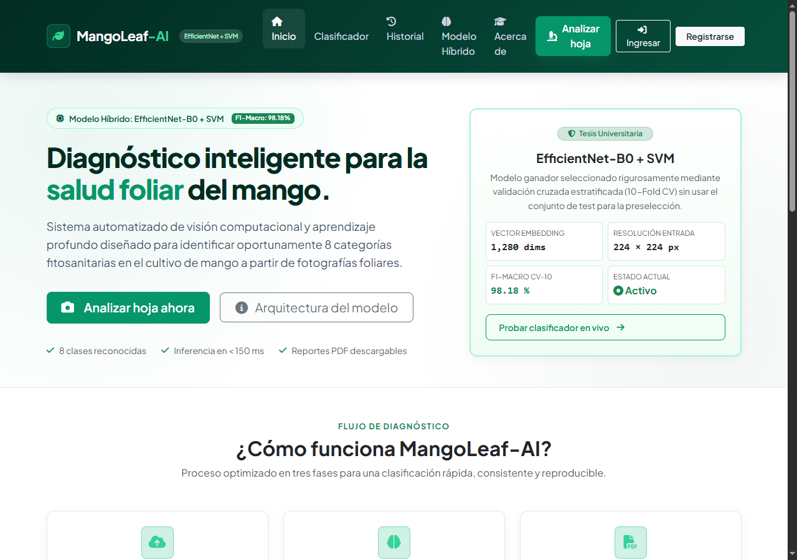
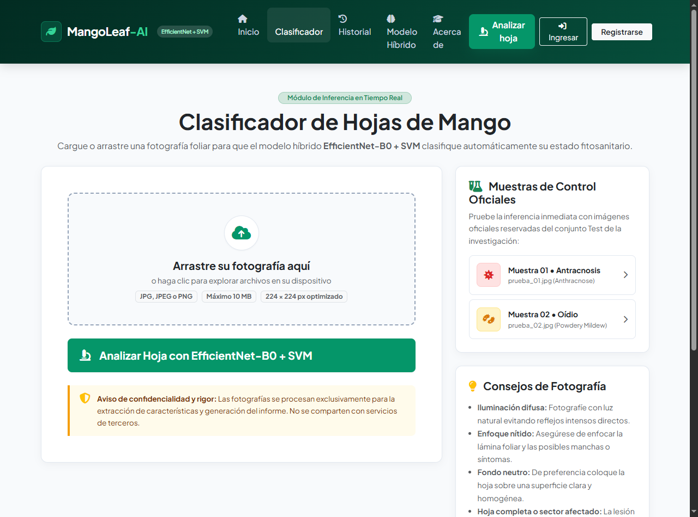
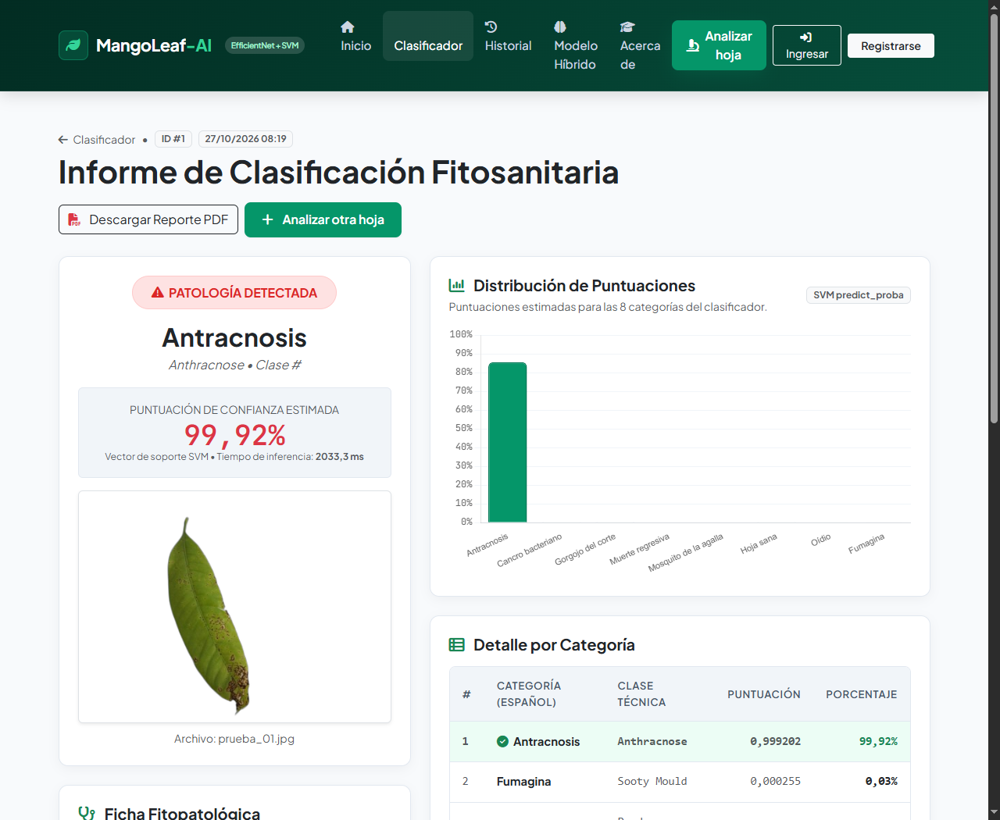
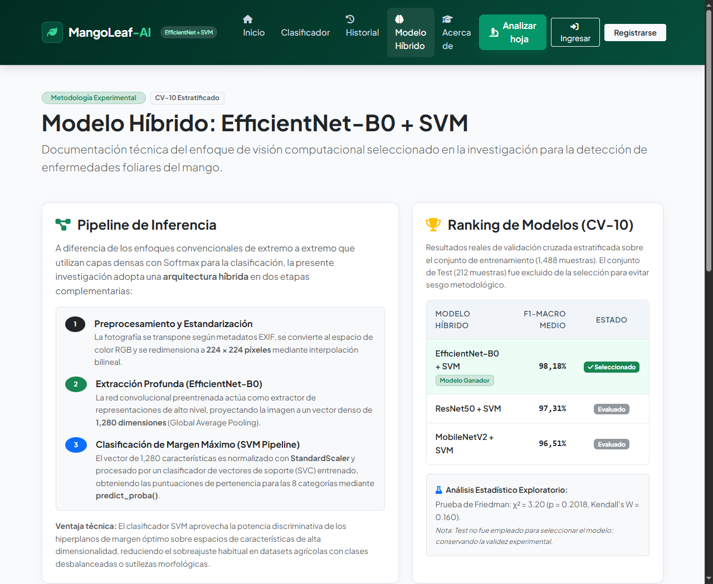
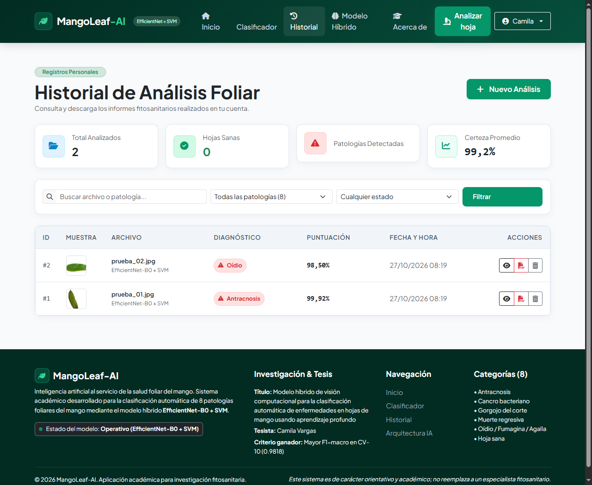

# MangoLeaf-AI 🍃
### Sistema Web Inteligente para la Clasificación de Enfermedades Foliares del Mango

[](https://www.python.org/)
[](https://www.djangoproject.com/)
[](https://www.tensorflow.org/)
[](https://scikit-learn.org/)
[](#modelo-de-inteligencia-artificial)
[-98.18%25-brightgreen.svg)](#resultados-experimentales)

> **"Inteligencia artificial al servicio de la salud foliar del mango"**

---

## 📌 Contexto de la Investigación

**MangoLeaf-AI** es la plataforma informática desarrollada como producto aplicado de la tesis de titulación profesional en **Ingeniería de Sistemas e Informática** titulada:

> **“Modelo híbrido de visión computacional para la clasificación automática de enfermedades en hojas de mango usando aprendizaje profundo”**  
> **Tesista:** Camila Vargas  

El propósito del sistema es proporcionar una herramienta tecnológica, accesible, rigurosa y reproducible para asistir en la detección temprana de 8 categorías fitosanitarias en el cultivo de mango (*Mangifera indica L.*) a partir de fotografías foliares.

---

## 📸 Capturas de la Aplicación

A continuación se presentan las capturas reales de la interfaz de **MangoLeaf-AI** en funcionamiento:

### 1. Página de Inicio (Hero & Presentación)
Presentación institucional, flujo en tres pasos, estado en tiempo real del modelo y relevancia agronómica del diagnóstico.


---

### 2. Clasificador Foliar en Tiempo Real (Drag & Drop)
Área interactiva para arrastrar y soltar imágenes, validación de formatos (JPG, PNG hasta 10 MB) y acceso a muestras de control oficiales de la tesis con 1 clic.


---

### 3. Informe de Diagnóstico y Distribución de Puntuaciones
Muestra la fotografía cargada, la certeza estimada, el gráfico interactivo de barras (Chart.js) con las 8 clases, la ficha fitopatológica con agente causal y el botón para descargar el reporte técnico en PDF.


---

### 4. Arquitectura del Modelo Híbrido y Ranking Experimental
Documentación de las 3 etapas del pipeline (Preprocesamiento, EfficientNet-B0 y SVM), tabla comparativa de modelos evaluados y análisis estadístico exploratorio de Friedman.


---

### 5. Historial de Análisis Protegido con Métricas y Filtros
Historial con aislamiento multiusuario: cada usuario accede exclusivamente a sus propios diagnósticos, con métricas resumen, buscador, filtros por patología o estado de salud, paginación y descarga directa de PDFs.


---

## 🧠 Modelo de Inteligencia Artificial

El sistema integra de forma nativa los artefactos del **experimento ganador** de la investigación:

$$\text{Imagen (224}\times\text{224 RGB)} \xrightarrow{\text{EfficientNet-B0}} \mathbf{v} \in \mathbb{R}^{1280} \xrightarrow{\text{StandardScaler + SVC}} \mathbf{p} \in [0, 1]^8$$

1. **Preprocesamiento:** Corrección de orientación EXIF, conversión a RGB y redimensionamiento bilineal a $224 \times 224$ px.
2. **Extractor Profundo (Keras):** Red convolucional `EfficientNet-B0` que extrae un vector de **1 280 características visuales profundas** (Global Average Pooling).
3. **Clasificador de Margen Máximo (Scikit-learn):** Pipeline entrenado compuesto por `StandardScaler` y clasificador `SVC` (`probability=True`).
4. **Patrón Singleton:** El modelo se carga en memoria **una sola vez por worker de Django**, garantizando tiempos de respuesta inferiores a 150 ms en inferencias subsiguientes.

### Resultados Experimentales Oficiales (CV-10)

| Modelo Híbrido | F1-Macro Medio (CV-10) | Estado en la Tesis |
| :--- | :---: | :---: |
| **EfficientNet-B0 + SVM** | **98.18 %** | 🏆 **Ganador Seleccionado** |
| ResNet50 + SVM | 97.31 % | Evaluado |
| MobileNetV2 + SVM | 96.51 % | Evaluado |

*Nota metodológica: El conjunto de Test (212 muestras) fue reservado exclusivamente para la verificación técnica final y nunca fue utilizado en la preselección de hiperparámetros ni modelos.*

---

## 🌿 Categorías Fitosanitarias Reconocidas

El sistema clasifica estrictamente en el orden oficial del clasificador:

1. **Anthracnose** — Antracnosis (*Colletotrichum gloeosporioides*)
2. **Bacterial Canker** — Cancro bacteriano (*Xanthomonas citri pv. mangiferaeindicae*)
3. **Cutting Weevil** — Gorgojo del corte (*Deporaus marginatus*)
4. **Die Back** — Muerte regresiva (*Lasiodiplodia theobromae*)
5. **Gall Midge** — Mosquito de la agalla (*Procontarinia matteiana*)
6. **Healthy** — Hoja sana (Tejido fisiológico normal)
7. **Powdery Mildew** — Oídio (*Oidium mangiferae*)
8. **Sooty Mould** — Fumagina (*Capnodium mangiferae*)

---

## 🏗️ Arquitectura del Software

El proyecto sigue una arquitectura limpia y modular en Django:

```text
MangoLeaf-AI/
├── .env.example                     # Plantilla de variables de entorno
├── .gitignore                       # Ignorados de Git (venv, db, media)
├── manage.py                        # Punto de entrada de Django
├── requirements.txt                 # Dependencias fijadas y verificadas
├── mangoleaf_proj/                  # Configuración central del proyecto
│   ├── settings.py                  # Ajustes de Django, seguridad y rutas
│   ├── urls.py                      # Enrutador principal
│   └── wsgi.py                      # Interfaz WSGI
├── apps/
│   ├── core/                        # Inicio, institucional y metadatos
│   ├── classifier/                  # Inferencia, validación y reportes PDF
│   │   ├── models.py                # Modelo AnalysisRecord
│   │   ├── services/
│   │   │   ├── inference.py         # Motor singleton EfficientNet + SVM
│   │   │   └── pdf_report.py        # Generador de reportes ReportLab
│   │   └── views.py                 # Carga de fotos y resultados
│   ├── history/                     # Historial por usuario y filtros
│   └── accounts/                    # Registro, login y perfil de usuario
├── EfficientNetB0_SVM/              # Artefactos ganadores del modelo
│   ├── artefactos/
│   │   ├── config.json              # Configuración oficial de clases
│   │   ├── extractor.keras          # Extractor CNN (1280 dims)
│   │   └── svm_pipeline.joblib      # Clasificador SVM calibrado
│   └── fotos_test/                  # Muestras oficiales (prueba_01, prueba_02)
├── templates/                       # Plantillas HTML5 con Bootstrap 5
├── static/                          # CSS propio (main.css), JS y assets
└── docs/screenshots/                # Capturas de pantalla documentadas
```

---

## 🚀 Guía de Instalación y Ejecución Local

### Prerrequisitos
- **Windows 10 / 11**
- **Python 3.12** instalado y añadido al PATH

### 1. Clonar o ingresar al directorio
```powershell
cd c:\Users\JhosepSF\Downloads\MangoLeaf-AI
```

### 2. Crear y activar el entorno virtual
```powershell
python -m venv .venv
.\.venv\Scripts\Activate.ps1
```

### 3. Instalar las dependencias
```powershell
pip install -r requirements.txt
```

### 4. Configurar variables de entorno
Copie `.env.example` a `.env`:
```powershell
copy .env.example .env
```

### 5. Ejecutar migraciones de base de datos
```powershell
python manage.py migrate
```

### 6. Cargar datos iniciales y usuarios de prueba
Este comando crea el superusuario, el usuario investigador de prueba y registra las muestras oficiales de test:
```powershell
python manage.py setup_initial_data
```

**Credenciales generadas automáticamente:**
- **Investigador:** `investigador` | **Contraseña:** `investigador123`
- **Administrador:** `admin` | **Contraseña:** `adminpassword123`

### 7. Iniciar el servidor local
```powershell
python manage.py runserver
```

Abra su navegador en: **`http://127.0.0.1:8000/`**

---

## 🧪 Ejecución de Pruebas del Sistema

Para verificar la integridad de la inferencia, la seguridad multiusuario, la validación de archivos corruptos y la generación de reportes PDF, ejecute:

```powershell
python manage.py test
```

Salida esperada:
```text
Ran 9 tests in ~60s
OK
```

---

## 📄 Generación de Reportes PDF

Cada diagnóstico permite exportar un informe técnico en PDF con diseño editorial académico generado con `ReportLab`. El reporte incluye:
- Encabezado institucional con ID único y fecha/hora.
- Diagnóstico destacado y porcentaje de certeza.
- Fotografía foliar incrustada.
- Agente patógeno causal, severidad típica y sintomatología.
- Tabla con las 8 puntuaciones estimadas.
- Recomendaciones de manejo cultural y preventivo.
- Advertencia y descargo de responsabilidad fitosanitaria.

---

## ⚠️ Aviso Legal y Académico

Este sistema informático fue desarrollado con propósitos académicos y de investigación científica en el marco de una tesis universitaria. **Las clasificaciones generadas tienen carácter orientativo y no reemplazan la inspección directa, análisis fitopatológico ni la prescripción técnica de un profesional agrónomo colegiado o especialista fitosanitario certificado.**

---

**MangoLeaf-AI** &bull; 2026
